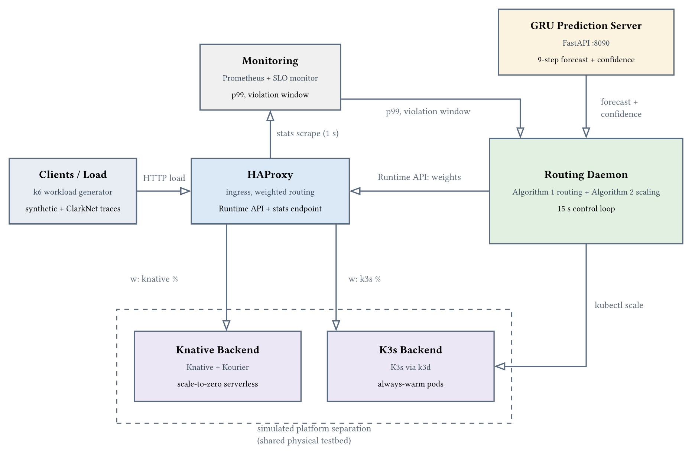

**Ringkasan Penelitian Tesis**

**Nama** : Muhammad Zahid Masruri | **NRP** : 6025221041 | **Prodi** : Magister Komputer (M.Kom), Teknik Informatika, ITS, 17 September 2026
**Judul** : Decision Making and Elastic Scalability Management in Heterogeneous Cloud Environments Based on Workload Prediction

**Konteks.** Kubernetes hemat karena kontrol penuh atas klaster, tetapi autoscaler bawaannya lambat karena baru bereaksi setelah beban naik. Serverless (Knative) menambah kapasitas dalam hitungan detik, tetapi lebih mahal untuk beban yang berlangsung lama. Penelitian ini menggabungkan keduanya dengan prediksi beban kerja memakai GRU. Dua keputusan yang dijawab: kapan kapasitas Kubernetes ditambah, dan kapan trafik dialihkan ke serverless.

**Mengapa penting.** Provisioning node butuh 45 sampai 120 detik, lebih lama daripada waktu reaksi kontroler, sehingga kapasitas baru siap setelah trafik puncak lewat. Penelitian yang membandingkan kontroler reaktif dan prediktif pada kasus hybrid masih terbatas.

**Rumusan masalah.** (1) Bagaimana merancang prediksi beban kerja trafik aplikasi web memakai GRU? (2) Bagaimana memodifikasi algoritma ElaX untuk scaling klaster dan distribusi trafik ke tipe klaster berbeda? (3) Bagaimana mengevaluasi mekanisme tersebut pada lingkungan terintegrasi Kubernetes dan serverless?

**Metodologi.** Model GRU:

- Input: 30 sampel trafik terakhir, interval sampling 15 detik
- Output: 9 langkah prediksi, horizon 135 detik
- Training: data ClarkNet 15 detik pada amplitudo replay, split kronologis dengan embargo 38 sampel (train 0–22500, validasi 22539–26205, test 26243–40315); jendela replay 28940–29020 berada di dalam data test dan tidak dipakai saat training
- Validasi: trace HTTP ClarkNet dan Calgary

ElaX dimodifikasi jadi dua algoritma:

- **Algoritma 1 (routing, hanya dari beban aktual).** Tiap 15 detik hitung kapasitas efektif K8s dari replika yang ready (R_efektif 16,65 RPS/replika), lalu alihkan lonjakan di atas kapasitas ke serverless. Prediksi GRU tidak dipakai untuk routing, hanya untuk memberi label PREDICTIVE. Prioritas: SCALE_OUT $>$ PREDICTIVE $>$ OPTIMIZE_COST $>$ MAINTAIN. Setiap langkah menggeser split sepuluh poin persen.
- **Algoritma 2 (scaling, satu-satunya jalur prediksi).** Jumlah pod dihitung dengan rumus R = alfa dikali x ditambah beta. Mode reaktif memakai beban aktual; mode prediktif memakai batas atas prediksi GRU (upper envelope, dikalikan ROUTING_PREDICTIVE_SHRINK), dan hanya diterapkan apabila target prediktif melebihi target aktual, dengan hold 90 detik. Ini satu-satunya tempat prediksi mengubah perilaku: scale-up dan scale-down replika K8s.
- **Konsolidasi node.** Seperti Cluster Autoscaler: bila utilisasi di bawah 50% dan pod-nya bisa dipindah, node dihapus.

{width=15.5cm}

Empat skenario dibandingkan, memakai beban dari trace ClarkNet 30–164 RPS (rata-rata 73 RPS), metrik utama p99 (SLO 200 ms), dan S3 vs S4 diuji berpasangan (uji permutasi satu arah, alfa 0,05):

| Skenario | Scaling | Trafik |
|---|---|---|
| S1 Kubernetes | HPA bawaan | 100% Kubernetes |
| S2 serverless | KPA (Knative) | 100% serverless |
| S3 hibrida reaktif | Algoritma 1 + 2, beban aktual | dinamis: Kubernetes + serverless |
| S4 hibrida prediktif | Algoritma 1 + 2, prediksi GRU | dinamis: Kubernetes + serverless |

**Hasil evaluasi.** Eksperimen terakhir memakai model ClarkNet (artefak 20623c19, 13 September 2026): perbandingan berpasangan n=10 (`2026-09-13_h2-confirmatory-10p`) dan n=5 (`2026-09-13_h2-pair-5p`). Semua run lolos uji validitas dan 100% prediksi terkirim.

Perbandingan berpasangan n=10 (model ClarkNet):

| Metrik | S3 reaktif | S4 prediktif |
|---|---|---|
| p99 rata-rata (ms) | 420,2 | 316,0, selisih -104,2 (p = 0,168 satu arah; d = -0,33 kecil; CI 95% [-293,9; +79,5] mencakup nol) |
| p95 rata-rata (ms) | 129,5 | 118,1, selisih -11,4 (p = 0,333; d = -0,15) |
| Pelanggaran SLO | 1.874 | 1.425, selisih -448,5 (p = 0,288; d = -0,18) |
| Porsi serverless | 21,4% | 12,9% (S4 menahan kapasitas K8s lebih awal sehingga ketergantungan pada serverless turun) |
| Replica-seconds | 6.851 | 10.002 (S4 menahan lebih banyak replika warm) |

Kesimpulan jujur dari uji utama: **H2 tidak didukung** (p = 0,168 tidak melewati 0,05). Hasil n=5 bulan Juli (188,5 vs 126,0 ms, p = 0,0312) memakai model yang dilatih dengan data sintetis, bukan model terbaik ClarkNet, sehingga tidak lagi dipakai sebagai hasil utama, melainkan dicatat sebagai hasil historis.

{width=13cm}

- Analisis sensitivitas terhadap beban host (post-hoc, dilaporkan terbuka): beban puncak CPU host berkorelasi dengan p99 (r = 0,69); tiga run terlambat semuanya terjadi saat beban host belum stabil (kesibukan 66–100%). Pada 8 pasangan yang beban host kedua sisinya di bawah 40%: selisih -101,3 ms, p = 0,039, d = -0,74, S4 menang 6 dari 8. Ini analisis tambahan, bukan uji utama; hasilnya menunjukkan efek yang tertutup noise dan mendukung pengulangan eksperimen pada host yang idle.
- Hasil per pasangan n=10 (S3 vs S4, ms): 1765,1 vs 1037,8; 162,6 vs 658,0; 289,7 vs 132,7; 372,7 vs 252,4; 483,1 vs 135,8; 290,6 vs 103,2; 315,8 vs 223,5; 172,4 vs 197,5; 191,4 vs 285,2; 158,7 vs 133,6.
- Perbandingan n=5 September (artefak sama, 20623c19): selisih +153,3 ms (p = 0,656), S4 lebih lambat; satu outlier di S3 run 1 (1275 ms) dan dua outlier di S4 (1837, 817 ms) mendominasi rata-rata.
- Uji konsolidasi node (n=1, diagnostik): S4 menahan p99 113 ms vs S3 228 ms (-50,5%), SLO 40 vs 1.085, dengan biaya 5% lebih tinggi — kondisi di mana prediksi paling berguna (mencegah penghapusan node yang segera dibutuhkan kembali).
- Akurasi GRU (protokol bebas kebocoran data, amplitudo replay): holdout RMSE 29,635 ± 0,016; skor skill 0,216 terhadap model persistensi (prediksi naif yang mengulang nilai terakhir); RMSE 39,6% dari rata-rata beban pada data uji dari trace asli — target awal tidak tercapai di sana, dan model setara dengan autoregresi linear pada jendela yang sama (29,465). Target tercapai pada data sintetis: RMSE 5,2% dan MAE 4,1% dari rata-rata. Angka lama 4,75%/6,01%/17,78% dari protokol sebelumnya tidak dipakai lagi. Dari dua belas varian representasi, tidak ada yang mengalahkan model linear pada fold seleksi; kesimpulannya: prediktor titik yang dipakai seharusnya autoregresi linear, sedangkan prediksi GRU dipakai sebagai sinyal batas atas (upper envelope), bukan estimasi titik.
- Angka biaya berasal dari model perkiraan, bukan tagihan cloud yang sebenarnya.

| Komponen | Cara hitung |
|---|---|
| Node Kubernetes | EC2 t3.medium USD 0,0416/jam dikalikan umur node yang terukur (dari log provisioning) |
| Control plane | EKS per jam |
| Serverless | Provisioned Concurrency Lambda: jumlah instance = RPS dikalikan waktu eksekusi, ditagih per 300 detik |
| Batasan model | Replika warm tidak dihitung; S4 memakai 5 replika vs S3 3, sekitar USD 2,2/bulan lebih mahal jika dihitung per vCPU-detik |

**Kesimpulan.**

- (1) GRU memenuhi target akurasi pada data sintetis (RMSE 5,2%, MAE 4,1%) dan cukup cepat untuk keputusan real-time (inferensi ~40 ms), tetapi pada trace asli ia setara dengan model linear (bukan keunggulan akurasi), sehingga dipakai sebagai sinyal batas atas dengan gerbang confidence.
- (2) ElaX menjadi 2 algoritma: Algoritma 1 untuk routing memakai beban aktual dan kapasitas replika yang ready; Algoritma 2 untuk scaling adalah satu-satunya jalur prediksi (target prediktif hanya dipakai bila melebihi target aktual). PREDICTIVE adalah label aksi routing saat predicted_upper melebihi beban aktual, bukan jalur split tersendiri.
- (3) Pada eksperimen terakhir dengan model ClarkNet (n=10, artefak 20623c19): S4 lebih cepat 104,2 ms tetapi tidak signifikan (p = 0,168), pelanggaran SLO turun 448,5 dengan biaya yang sama. H2 tidak didukung pada uji utama. Replikasi pra-registrasi pada host sepi dengan gerbang beban (10 pasangan, 20 run valid) memberi selisih −13,6 ms (p = 0,307, d = −0,16), dan pooled 25 pasangan memberi −16,5 ms (95% CI [−194,0, +182,5], p = 0,50). Estimasi subset host idle yang lama (p = 0,039) tidak bertahan terhadap replikasi; itu artefak pemilihan subset. Efek signifikan hanya muncul pada uji konsolidasi (n=1).
- Berlaku dengan 3 syarat: horizon prediksi menutupi jeda provisioning node, konsolidasi node mengikuti Cluster Autoscaler, baseline reaktif disetel secara wajar — ditambah syarat keempat dari eksperimen terakhir: pengukuran dilakukan pada host yang idle (data beban host tercatat per run).
